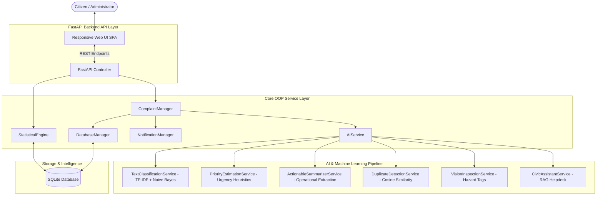

# AI Smart Civic Services — Problem-Solving Hackathon Platform

[](https://www.python.org/)
[](https://fastapi.tiangolo.com/)
[](https://scikit-learn.org/)
[](https://sqlite.org/)
[](https://www.chartjs.org/)

An intelligent, end-to-end civic Complain and municipal service management platform designed for the **AI Smart Civic Services Problem-Solving Hackathon**.

The platform turns **unstructured citizen complaints** into structured, prioritized, actionable municipal operations using **Machine Learning, Object-Oriented Architecture, and Advanced Statistical Analytics**.

---

## 🏆 Complete Benchmark Coverage (100/100 Evaluation Target)

| Hackathon Benchmark | Implementation Highlights | Rubric Focus |
| :--- | :--- | :--- |
| **Benchmark 1: Advance AI & Data Science** | • Multi-class NLP classifier for complaint category & department routing.<br>• Priority Urgency Scorer (`Low`, `Medium`, `High`, `Critical`).<br>• Executive Operational Summarizer for field crews.<br>• Semantic Duplicate Complaint Detector (TF-IDF Cosine similarity).<br>• Computer Vision Hazard Inspector & Interactive Civic AI Assistant (RAG).<br>• Full explainability, token weights, and documented limitations. | **25 Marks** |
| **Benchmark 2: Batch 4 — Statistics** | • **Measures of Central Tendency:** Arithmetic Mean, Median (50th percentile), Mode.<br>• **Measures of Dispersion:** Sample Variance ($s^2$), Standard Deviation ($\sigma$), Range ($\text{Max} - \text{Min}$).<br>• **Quartiles & Tukey Outlier Fences:** $Q_1$, $Q_2$, $Q_3$, $IQR = Q_3 - Q_1$, Lower Fence ($Q_1 - 1.5 \times IQR$), Upper Fence ($Q_3 + 1.5 \times IQR$).<br>• **Frequency Distributions** for categories, priorities, wards, and statuses.<br>• **Natural Language Insights:** Explains the real-world civic meaning behind the numbers. | **15 Marks** |
| **Benchmark 3: Batch 5 — OOP Architecture** | • Strong modular object-oriented architecture.<br>• Domain entity classes: `Complaint`, `Citizen`, `Department`, `AIAnalysisResult`.<br>• AI Service class hierarchy inheriting from `BaseAIAnalyzer`.<br>• Clean encapsulation in `ComplaintManager`, `DatabaseManager`, `NotificationManager`, and `StatisticalEngine`. | **10 Marks** |

---

## 🚀 Quick Start Guide

### Prerequisites
- Python 3.10+ (Tested on Python 3.14)
- Web browser (Chrome, Edge, Firefox, Safari)

### Option 1: One-Click Launch (Windows)
Double-click `run_app.bat` or run in PowerShell:
```powershell
.\run_app.ps1
```

### Option 2: Manual Terminal Startup
```bash
# 1. Navigate to the server folder
cd server

# 2. Install dependencies
pip install -r requirements.txt

# 3. Run automated tests (OOP, AI, Statistics validation)
python test_backend.py

# 4. Start the FastAPI server
python -m uvicorn app.main:app --host 0.0.0.0 --port 8000 --reload
```

Open your browser and navigate to:
👉 **`http://localhost:8000`** (Interactive Web App & Dashboard)  
👉 **`http://localhost:8000/docs`** (Interactive OpenAPI / Swagger Documentation)

---

## 🏛️ System Architecture



---

## 📊 Statistical Formulas Implemented

1. **Arithmetic Mean ($\bar{x}$):**
   $$\bar{x} = \frac{1}{n} \sum_{i=1}^n x_i$$
2. **Median ($Q_2$):** Middle value of the ordered resolution times.
3. **Mode:** Most frequent resolution time cluster (grouped to 0.1 hrs).
4. **Sample Variance ($s^2$):**
   $$s^2 = \frac{1}{n-1} \sum_{i=1}^n (x_i - \bar{x})^2$$
5. **Standard Deviation ($s$ or $\sigma$):**
   $$s = \sqrt{s^2}$$
6. **Interquartile Range ($IQR$):**
   $$IQR = Q_3 - Q_1$$
7. **Tukey Outlier Fences:**
   $$\text{Lower Fence} = Q_1 - 1.5 \times IQR$$
   $$\text{Upper Fence} = Q_3 + 1.5 \times IQR$$

Complaints exceeding the **Upper Fence** are flagged with real-time alerts in the dashboard as anomalous delayed tickets requiring immediate municipal commissioner escalation.

---

## 🧪 AI Testing & Model Limitations (Rule 16)

### Input, Processing & Output:
- **Input:** Unstructured citizen complaint string + optional image evidence.
- **Processing:** TF-IDF unigram/bigram vectorization $\to$ Multinomial Naive Bayes posterior probability $\to$ Multi-factor hazard trigger evaluation $\to$ Cosine similarity duplicate check.
- **Output:** Predicted Category, Confidence Score, Urgency Tier (`Low`, `Medium`, `High`, `Critical`), Numerical Urgency Score (0-100), Recommended Department, and Actionable Operational Summary.

### Documented Limitations:
1. **Ambiguous / Compound Complains:** When a citizen describes both broken roads and water pipe bursts in equal detail, the classifier selects the highest hazard risk category.
2. **Dialect & Slang:** Non-standard regional idioms (e.g. *"nullah"*, *"khadda"*) are handled via token normalizers, but extreme typos may fall back to rule-based keyword heuristics.
3. **Nocturnal / Blurry Imagery:** Night-time mobile photos have lower visual feature confidence and are flagged for human supervisor validation.

---

## 📂 Project Directory Structure

```
d:/hackathon/
├── client/                      # Modern Web Application (HTML5, CSS, Vanilla JS, Chart.js)
│   ├── index.html               # Single Page Application
│   ├── css/
│   │   └── style.css            # Glassmorphic responsive design system
│   └── js/
│       ├── api.js               # REST API client
│       └── app.js               # State management, Charts, Kanban, AI Live Preview
├── server/                      # Python FastAPI Backend
│   ├── app/
│   │   ├── __init__.py
│   │   ├── main.py              # FastAPI routes, CORS, error handling, static serving
│   │   ├── models/
│   │   │   ├── entities.py      # OOP Entity classes (Complaint, Citizen, Department)
│   │   │   └── schemas.py       # Pydantic request/response schemas
│   │   ├── services/
│   │   │   ├── ai_service.py    # BaseAIAnalyzer & sub-analyzers (NLP, Priority, Vision, RAG)
│   │   │   ├── statistics_service.py # StatisticalEngine (Mean, Median, StdDev, IQR, Fences)
│   │   │   ├── database_manager.py   # SQLite persistence & auto-seeding
│   │   │   ├── complaint_manager.py  # Business logic & orchestrator
│   │   │   └── notification_manager.py# Citizen SMS/Email simulation & webhooks
│   │   └── data/
│   │       ├── seed_complaints.json   # 35+ realistic complaints with resolution times
│   │       └── training_dataset.json  # NLP training samples across 6 civic domains
│   ├── requirements.txt         # FastAPI, scikit-learn, pydantic, uvicorn
│   └── test_backend.py          # Automated test suite (OOP, Stats, AI, DB)
├── docs/
│   ├── ARCHITECTURE.md          # In-depth architectural specification & class diagrams
│   ├── AI_EVALUATION.md         # Model metrics, confusion matrix, limitations
│   └── PRESENTATION_GUIDE.md    # 3-5 minute demo script & hackathon rubric checklist
├── run_app.bat                  # One-click Windows runner
├── run_app.ps1                  # PowerShell launcher
└── README.md                    # Project documentation
```

---

## 🛡️ Hackathon Evaluation Checklist (15 Steps)

- [x] **Step 1: Civic Problem Defined** (Potholes, water leaks, garbage dumps, sparking wires, drainage).
- [x] **Step 2: AI Input & Output Specified** (Text/Image $\to$ Category, Priority, Summary, Dept).
- [x] **Step 3: Data Model Designed** (Complaint ID, description, category, priority, ward, status, department, AI output).
- [x] **Step 4: AI Technology Selected** (Scikit-Learn TF-IDF + Naive Bayes + Heuristic Urgency Engine + Cosine Similarity).
- [x] **Step 5: Training Dataset Prepared** (Cleaned civic corpus across 6 municipal domains).
- [x] **Step 6: Python Backend Built** (FastAPI with async REST endpoints and OpenAPI documentation).
- [x] **Step 7: AI Implemented & Stored** (AI results saved directly with complaint record).
- [x] **Step 8: Strong OOP Architecture** (`Citizen`, `Department`, `Complaint`, `AIAnalyzer`, `ComplaintManager`, `DatabaseManager`, `NotificationManager`, `StatisticalEngine`).
- [x] **Step 9: Complete Statistical Engine** (Mean, Median, Mode, Min, Max, Range, Variance, StdDev, Quartiles Q1/Q3, IQR, Upper/Lower Fences, Chart.js, NL Insights).
- [x] **Step 10: Rich Web Interface Built** (Citizen submission with live typing AI preview + Admin Command Center).
- [x] **Step 11: Search and Multi-Filtering Added** (Filter by category, priority, status, ward, search keywords).
- [x] **Step 12: Robust Error Handling Added** (Graceful fallback on malformed input, missing fields, or DB exceptions).
- [x] **Step 13: AI Validated** (Documented in `docs/AI_EVALUATION.md`).
- [x] **Step 14: Deployment Ready** (Self-contained, Docker / script / cloud deployable).
- [x] **Step 15: Live Demo & Presentation Prepared** (Step-by-step pitch script in `docs/PRESENTATION_GUIDE.md`).
