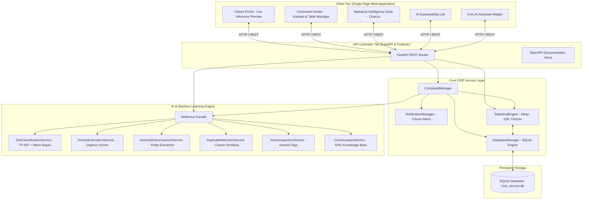
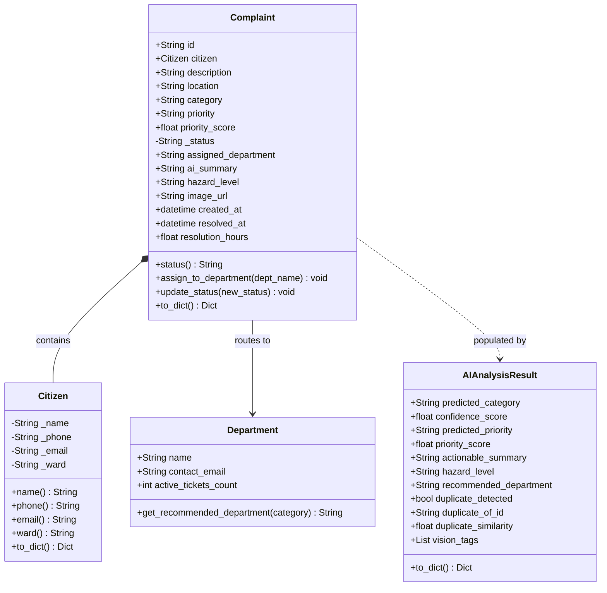
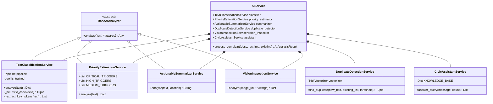

# System Architecture & Technical Specification

## AI Smart Civic Services Platform

---

## 1. High-Level Architecture Overview

The platform uses a layered, modular Object-Oriented Architecture (OOP) with clear separation of concerns between presentation, API controller routing, domain business services, machine learning inference, statistical computation, and data persistence.

---

## 2. Object-Oriented Class Hierarchy (Benchmark 3)

### 2.1 Domain Entities (`app.models.entities`)

---

## 3. AI Service Class Hierarchy

---

## 4. REST API Endpoint Specification

| Method | Endpoint | Description | Request Body | Response |
| :--- | :--- | :--- | :--- | :--- |
| `GET` | `/api/health` | System & AI model readiness status | None | Health JSON |
| `POST` | `/api/complaints` | Register complaint, run AI, persist & alert | `ComplaintCreateRequest` | Full registered complaint & AI output |
| `GET` | `/api/complaints` | Search & multi-filter complaints | Query params: `category`, `priority`, `status`, `ward`, `search` | List of `ComplaintResponse` |
| `GET` | `/api/complaints/{id}` | Retrieve specific complaint by ID | Path parameter | Single `ComplaintResponse` |
| `PATCH` | `/api/complaints/{id}/status` | Transition lifecycle status (Open $\to$ In Progress $\to$ Resolved) | `StatusUpdateRequest` | Updated complaint |
| `PATCH` | `/api/complaints/{id}/assign` | Reassign responsible municipal department | `AssignDepartmentRequest` | Updated complaint |
| `POST` | `/api/ai/analyze` | Live real-time AI inference preview for typing | `AIAnalyzeRequest` | `AIAnalyzeResponse` |
| `POST` | `/api/ai/assistant` | Interactive conversational RAG chatbot | `AssistantChatRequest` | `AssistantChatResponse` |
| `GET` | `/api/statistics` | Full Statistical Analytics payload | None | Descriptive stats, IQR, Fences, NL Insights |
| `POST` | `/api/seed/reset` | Reset SQLite database to 35 seed complaints | None | Confirmation JSON |
| `GET` | `/api/notifications` | View simulated SMS/Email audit logs | None | Notification array |
